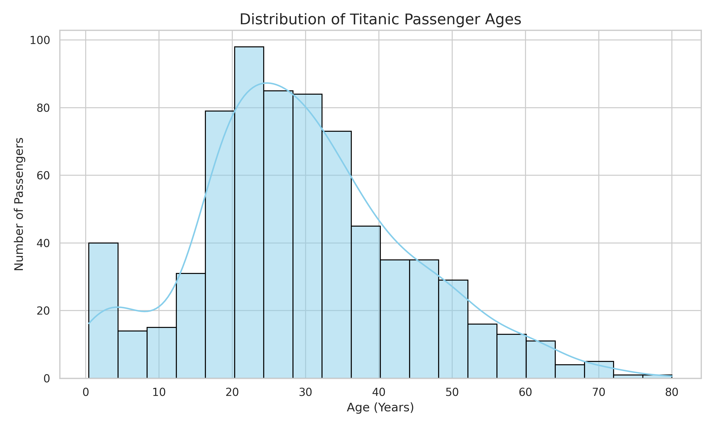
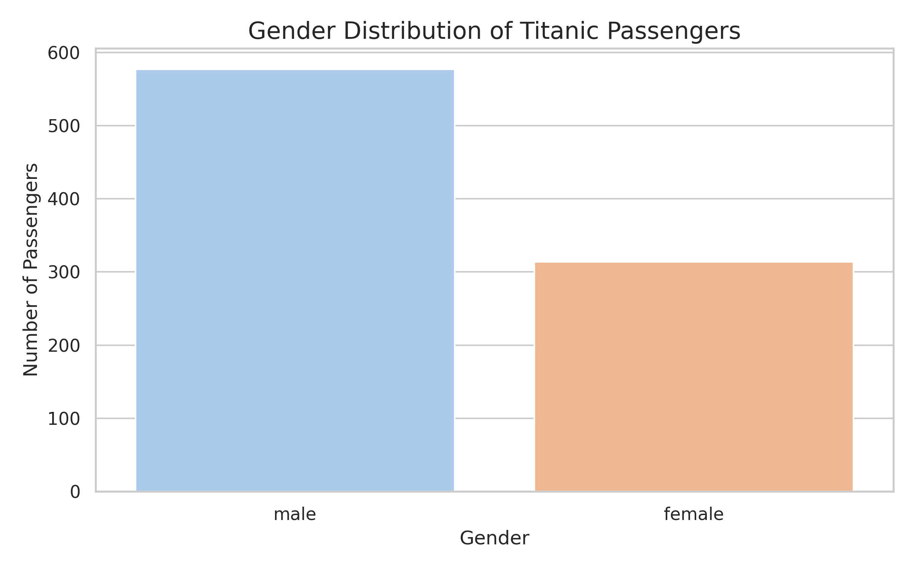

# PRODIGY_DS_01
## Titanic Passenger Demographics Visualization

### 📌 Project Overview
This project was completed as **Task 01** of my Data Science Internship at **Prodigy InfoTech**.

The objective is to visualize the distribution of Titanic passengers using a histogram and a bar chart to understand passenger demographics.

### 🎯 Objectives
- Analyze the age distribution of Titanic passengers.
- Visualize the gender distribution.
- Identify basic patterns using data visualization.

### 📊 Dataset
- **Dataset:** Titanic Passenger Dataset
- **Source:** [Seaborn Titanic Dataset](https://github.com/mwaskom/seaborn-data/blob/master/titanic.csv)
- **Total Records:** 891 passengers
- **Features:** Age, sex, passenger class, survival status, and other attributes.

### 🛠️ Technologies Used
- Python
- Pandas
- Matplotlib
- Seaborn
- Google Colab

### ⚙️ Implementation
1. Imported the required Python libraries.
2. Loaded the Titanic dataset using Pandas.
3. Explored the dataset and checked missing values.
4. Removed missing age values for age visualization.
5. Created a histogram to visualize passenger age distribution.
6. Created a bar chart to visualize gender distribution.
7. Analyzed the results.

### 📈 Visualizations

#### 1. Age Distribution

#### 2. Gender Distribution

### 🔍 Key Findings
- Average passenger age: approximately **29.7 years**.
- Median passenger age: **28 years**.
- Youngest passenger: approximately **0.42 years**.
- Oldest passenger: **80 years**.
- Male passengers: **577 (64.76%)**.
- Female passengers: **314 (35.24%)**.

### 💡 Conclusion
This project helped me understand how to explore a dataset, handle missing values in selected columns, and create meaningful visualizations using Python libraries.

### ▶️ How to Run
1. Open `PRODIGY_DS_01.ipynb`.
2. Open the notebook in Google Colab.
3. Run all cells to reproduce the visualizations.

---
**Internship:** Prodigy InfoTech  
**Track:** Data Science  
**Task:** 01 – Data Visualization  
**Repository:** PRODIGY_DS_01
